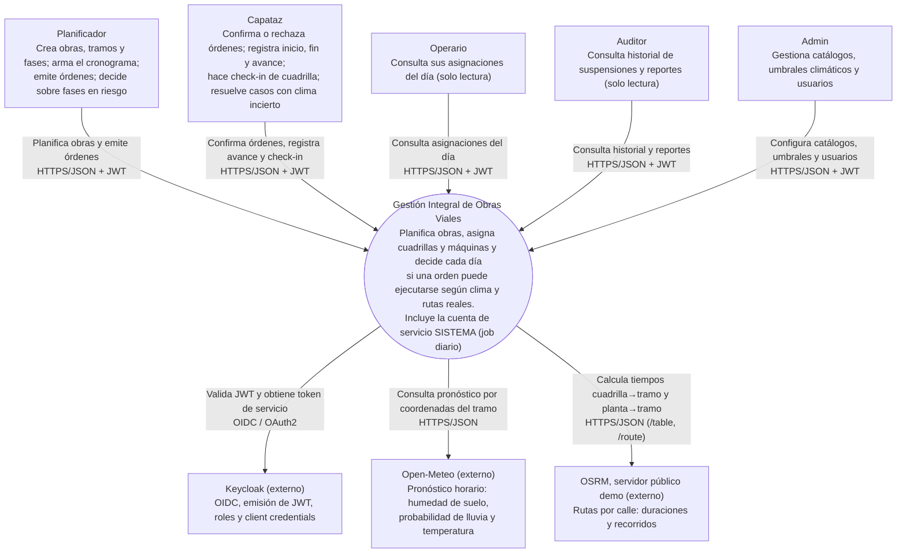
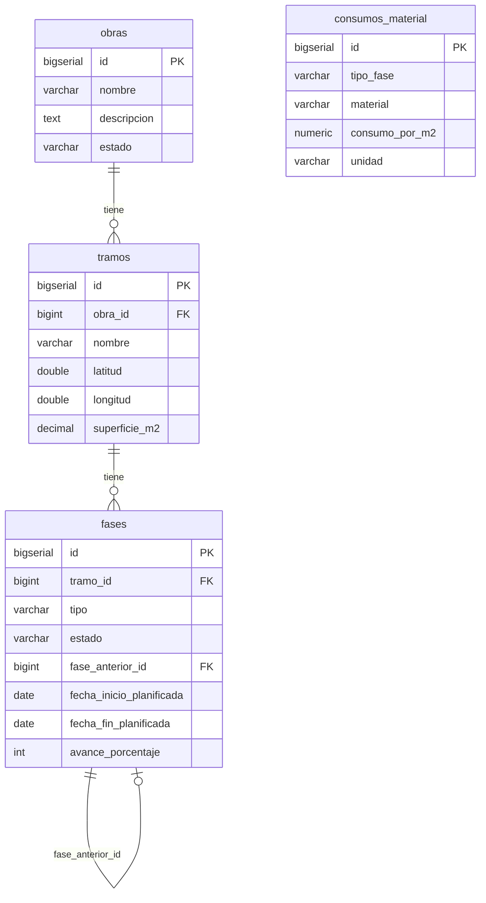
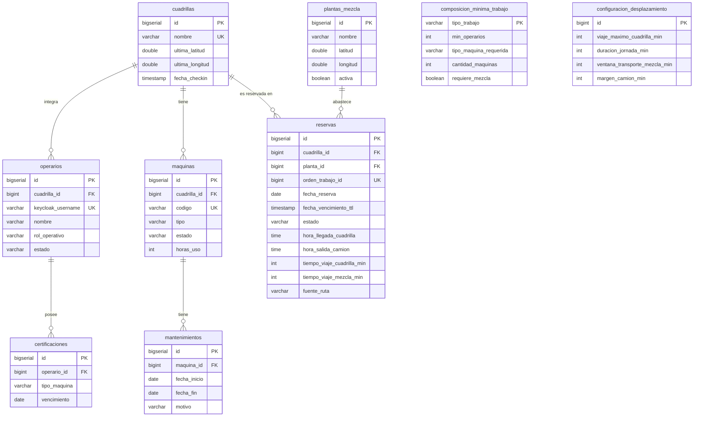
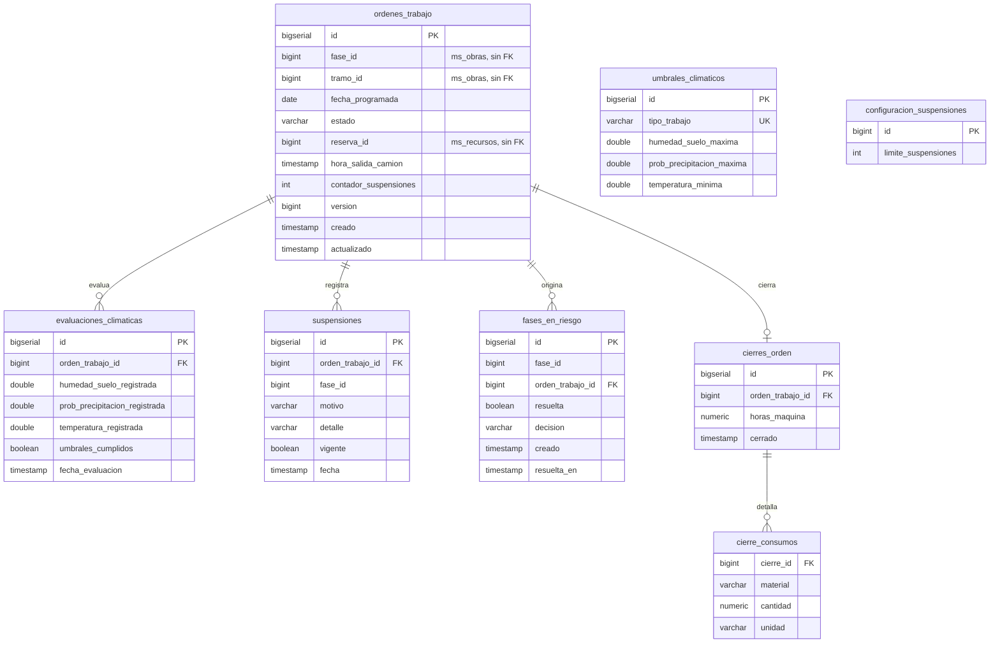

# Arquitectura: contexto (C1), modelo de datos (ER) y secuencia de la habilitación

Complementa el diagrama de contenedores (C2) de [`c2-contenedores.md`](c2-contenedores.md). Los diagramas están en Mermaid y se ven directamente en GitHub.

## 1. Contexto (C1)

Es el diagrama de Contexto del modelo C4 de la sección 05 del cuestionario. El sistema decide cada día si una cuadrilla puede ejecutar una obra, según el estado de la obra, los recursos, las rutas y el clima. Incluye la cuenta de servicio SISTEMA (job diario). Hay cinco actores, todos con rol de Keycloak, y tres sistemas externos.



Definición textual editable (la del cuestionario, PlantUML con C4-PlantUML):

```plantuml
@startuml C1_Contexto_Obras_Viales
!include https://raw.githubusercontent.com/plantuml-stdlib/C4-PlantUML/master/C4_Context.puml

LAYOUT_WITH_LEGEND()
title Diagrama de Contexto (C4 - Nivel 1) - Gestión Integral de Obras Viales con Control Climático de Ejecución

Person(planificador, "Planificador", "Crea obras, tramos y fases; arma el cronograma; emite órdenes; decide sobre fases en riesgo.")
Person(capataz, "Capataz", "Confirma o rechaza órdenes; registra inicio, fin y avance; hace check-in de cuadrilla; resuelve casos con clima incierto.")
Person(operario, "Operario", "Consulta sus asignaciones del día (solo lectura).")
Person(auditor, "Auditor", "Consulta historial de suspensiones y reportes (solo lectura).")
Person(admin, "Admin", "Gestiona catálogos, umbrales climáticos y usuarios.")

System(obras, "Gestión Integral de Obras Viales", "Planifica obras, asigna cuadrillas y máquinas, y decide cada día si una orden puede ejecutarse según clima y rutas reales. Incluye la cuenta de servicio SISTEMA (job diario).")

System_Ext(keycloak, "Keycloak", "Proveedor de identidad: OIDC, emisión de JWT, roles y client credentials.")
System_Ext(meteo, "Open-Meteo", "API pública de pronóstico horario: humedad de suelo, probabilidad de lluvia y temperatura.")
System_Ext(osrm, "OSRM (servidor público demo)", "API pública de rutas por calle: duraciones y recorridos.")

Rel(planificador, obras, "Planifica obras y emite órdenes", "HTTPS/JSON + JWT")
Rel(capataz, obras, "Confirma órdenes, registra avance y check-in", "HTTPS/JSON + JWT")
Rel(operario, obras, "Consulta asignaciones del día", "HTTPS/JSON + JWT")
Rel(auditor, obras, "Consulta historial y reportes", "HTTPS/JSON + JWT")
Rel(admin, obras, "Configura catálogos, umbrales y usuarios", "HTTPS/JSON + JWT")

Rel(obras, keycloak, "Valida JWT y obtiene token de servicio", "OIDC / OAuth2")
Rel(obras, meteo, "Consulta pronóstico por coordenadas del tramo", "HTTPS/JSON")
Rel(obras, osrm, "Calcula tiempos cuadrilla→tramo y planta→tramo", "HTTPS/JSON (/table, /route)")
@enduml
```

Cuatro de los cinco roles (Planificador, Capataz, Auditor y Admin) ya operan en la implementación; el Operario solo tendrá un endpoint propio (`GET /operarios/me/asignaciones`) cuando se mergee la Rama 1. Los reportes del Auditor y la gestión de usuarios por API están fuera de alcance: los usuarios se administran en Keycloak.

## 2. Modelo de datos (ER)

Hay una base por servicio (más la de Keycloak) en la misma instancia de PostgreSQL. **No hay claves foráneas entre bases**: los servicios se refieren a ids de otros servicios (`fase_id`, `tramo_id`, `orden_trabajo_id`, `reserva_id`) y los validan por HTTP. Los ids son `BIGSERIAL`: el cuestionario planteaba uuid y la implementación usa enteros autoincrementales.

Se obtuvo de las migraciones `V*.sql` de cada servicio, con los nombres de columna vigentes (por ejemplo, en `fases` las columnas `tipo` y `fase_anterior_id` son las renombradas en V3).

### 2.1 ms_obras



`consumos_material` es una tabla de referencia sin FK: se cruza por `tipo_fase` para calcular los materiales (RN-03).

### 2.2 ms_recursos



`composicion_minima_trabajo` (por tipo de trabajo) y `configuracion_desplazamiento` (una sola fila, `id = 1`) son tablas de configuración, sin FK.

### 2.3 ms_operaciones



`umbrales_climaticos` y `configuracion_suspensiones` son configuración, sin FK.

## 3. Secuencia de la habilitación diaria

El job (o un PLANIFICADOR) llama a `POST /api/operaciones/habilitaciones-diarias` con una fecha. Para cada orden PROGRAMADA de ese día, Operaciones ejecuta la habilitación en su propia transacción: una que falla no frena a las demás. Detalle de cada decisión en `DECISIONES.md`, sección «Habilitación de órdenes en ms-operaciones».

```mermaid
sequenceDiagram
    autonumber
    participant J as Job / PLANIFICADOR
    participant G as Gateway
    participant O as ms-operaciones
    participant B as ms-obras
    participant R as ms-recursos
    participant M as Open-Meteo

    J->>G: POST /habilitaciones-diarias {fecha} (JWT)
    G->>O: reenvía con el JWT
    loop por cada orden PROGRAMADA de la fecha (transacción propia)
        O->>B: GET /internos/fases/{id}/contexto-ejecucion (token SISTEMA)
        B-->>O: tipo de trabajo, coordenadas, faseAnteriorCompletada
        Note over O: RN-01: si la fase previa no está completa, 409 y la orden no cambia
        Note over O: RN-09: busca el umbral del tipo de trabajo
        O->>R: POST /internos/reservas (token SISTEMA)
        alt Recursos rechaza (RN-04 a RN-08) o está caído
            R-->>O: 422 o 503
            Note over O: la orden queda como estaba y el error se informa
        else reserva PROVISORIA (TTL 30 min)
            R-->>O: 201 reserva con hora de salida del camión
            Note over O: orden en RECURSOS_ASIGNADOS y luego EVALUACION_CLIMATICA
            O->>M: pronóstico en las coordenadas del tramo
            alt Open-Meteo falla (RN-10)
                M--xO: error o timeout
                Note over O: PENDIENTE_CONFIRMACION_CLIMATICA, conserva la reserva; el CAPATAZ decide
            else clima dentro de los umbrales
                M-->>O: datos
                O->>R: PATCH /reservas/{id}/confirmacion
                R-->>O: 200
                Note over O: HABILITADA
            else clima fuera de los umbrales (falla controlada)
                M-->>O: datos
                O->>R: PATCH /reservas/{id}/liberacion
                Note over O: SUSPENDIDA; se registra la suspensión
                O->>B: PATCH /fases/{id}/programacion (nueva fecha)
                Note over O: crea una orden nueva; al llegar al límite de suspensiones (RN-12)<br/>marca la fase en riesgo en Obras y decide el PLANIFICADOR
            end
        end
    end
    O-->>G: resultado por orden (estado y motivo)
    G-->>J: 200
```

Las tres salidas del clima corresponden a los escenarios de la demo: orden habilitada, orden suspendida por clima y orden rechazada por distancia (en el rechazo de Recursos, RN-07, la orden queda PROGRAMADA).
