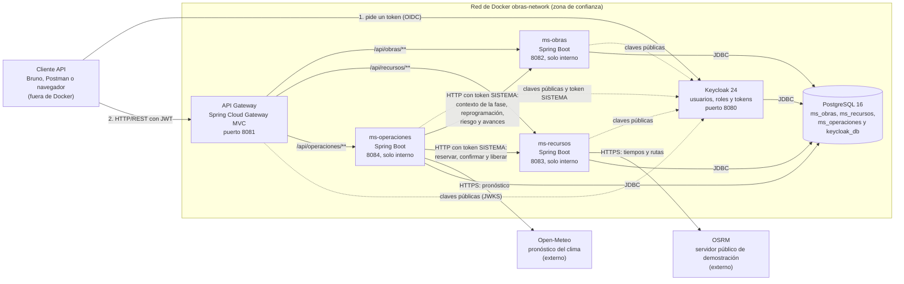

# Diagrama de contenedores (C2)

Este diagrama muestra lo que hoy levanta `docker compose up -d --build`: seis contenedores dentro de una red privada de Docker, más dos servicios externos a los que llegan Recursos y Operaciones. Se corresponde uno a uno con los servicios del `docker-compose.yml`. Si el compose cambia, este archivo tiene que cambiar con él.

Las líneas punteadas son las comprobaciones de seguridad: el gateway y cada servicio bajan de Keycloak las claves públicas para verificar la firma de los tokens, y Operaciones además le pide un token propio (la cuenta de servicio SISTEMA) para poder llamar a Obras y a Recursos.

## Qué se puede alcanzar desde afuera

| Contenedor | Publicado en la máquina | Por qué |
|---|---|---|
| `api-gateway` | `8081` | Es la única entrada a la API. |
| `keycloak` | `8080` | Quien quiera probar necesita pedir tokens. |
| `postgres` | `127.0.0.1:5432` | Solo para correr tests y servicios desde la propia máquina; no es accesible desde la red. |
| `ms-obras`, `ms-recursos`, `ms-operaciones` | nada | Solo se llega a ellos por el gateway o desde otro contenedor de la red. |

Esto es lo que llamamos zona de confianza. Aun así, no confiamos solamente en la red: cada servicio vuelve a validar el token y controla el rol con `@PreAuthorize`.

## Quién le habla a quién

- El cliente solo conoce dos direcciones: Keycloak (para el token) y el gateway (para la API). No sabe cuántos servicios hay detrás.
- Obras y Recursos no se llaman entre sí. Operaciones es el orquestador del proceso central: pide a Obras el contexto de la fase, pide a Recursos la reserva, consulta el clima y decide.
- Las llamadas entre servicios van directo al puerto interno (`ms-obras:8082`, `ms-recursos:8083`) y no pasan por el gateway.
- Cada servicio tiene su propia base y su propio usuario de base de datos. Ninguno lee las tablas de otro: si necesita un dato ajeno, lo pide por la API.

## Una diferencia con lo comprometido

En el documento de compromisos las llamadas del cliente al gateway figuran como HTTPS/REST. En lo desplegado hoy son HTTP: el compose no termina TLS. Para la demo local no cambia nada, pero conviene tenerlo presente al defender la seguridad del canal.

## Lo que no es un contenedor

`obras-commons` está en el código pero no en este diagrama, porque no se despliega por su cuenta: es una librería Maven que queda empaquetada dentro de `ms-obras`, `ms-recursos` y `ms-operaciones`. Aporta la seguridad base, el formato de errores, el filtro de correlation-id y el cliente que pide el token de SISTEMA. El gateway no la usa: es independiente a propósito y solo autentica.
