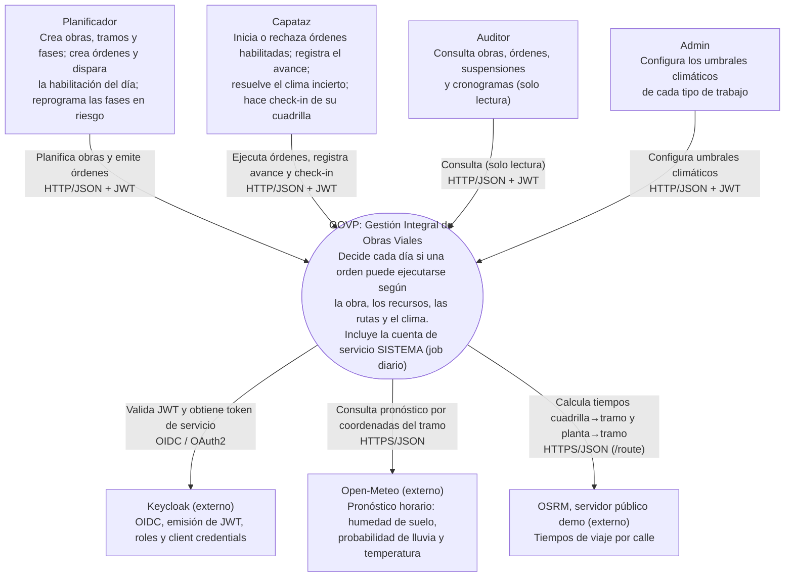
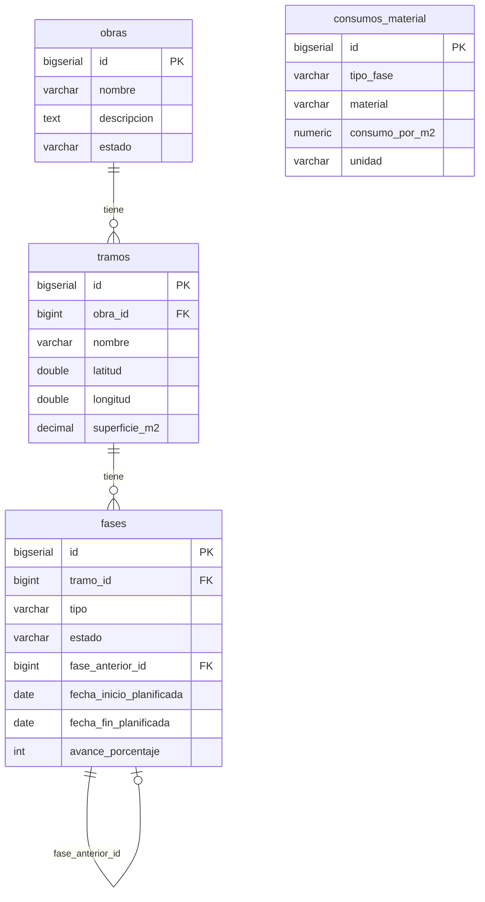
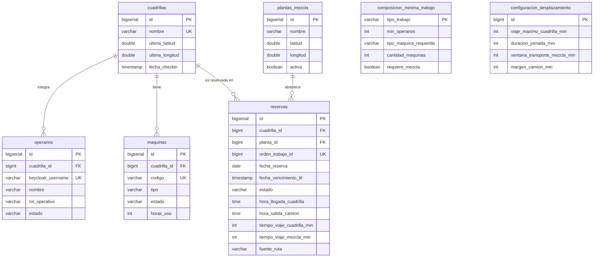
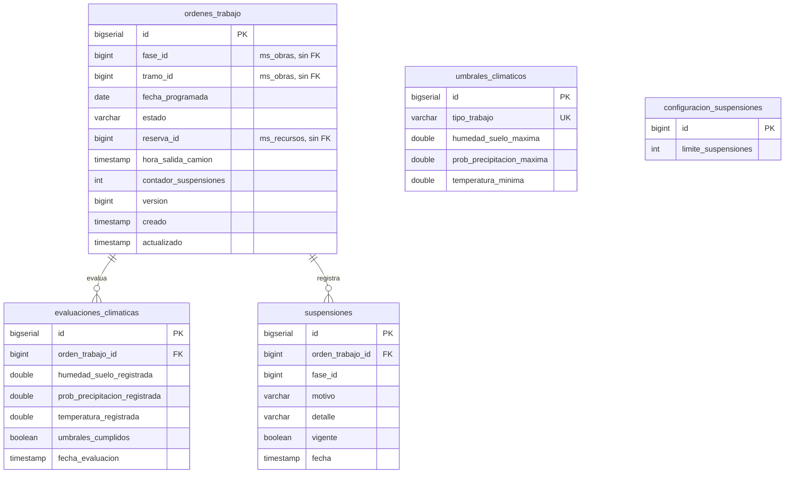

# Guía del proyecto GOVP

Reúne en un solo lugar lo que antes estaba repartido en siete documentos (arquitectura, guía de estudio, guía de defensa, guion de demo, consideraciones para el equipo, aviso a la cátedra y la parte general de la guía del código). Es la guía para **trabajar con el proyecto, presentarlo y defenderlo**: cómo se arranca, los diagramas, las reglas de negocio en detalle, la saga, la seguridad, los datos de demo, la infraestructura, las pruebas, las decisiones, las trampas conocidas, el guion de la demo, las preguntas probables y la comunicación con la cátedra.

Los otros dos documentos de lectura:
- [`vision-general.md`](vision-general.md): el programa y los microservicios explicados por arriba. Conviene leerlo primero.
- [`referencia-del-codigo.md`](referencia-del-codigo.md): cada archivo y cada método, y cómo funciona cada mecanismo de Spring que se usa (`@Bean`, `@Transactional`, `@PreAuthorize`, Resilience4j, etc.).

Documentos de evidencia que siguen aparte: `DECISIONES.md` (bitácora de decisiones), `matriz-requisitos.md`, `matriz-permisos.md`, las `trazabilidad-*.md`, `c2-contenedores.md`, `ms-obras-api.md` y `plan-recorte.md`.

Estado que describe: `main` del 2026-11-16, con el recorte aprobado por la cátedra y RN-04 quitada: 32 endpoints, 11 reglas de negocio, roles ADMIN, PLANIFICADOR, CAPATAZ y AUDITOR, y la cuenta de servicio SISTEMA.

---

## 1. Cómo arrancar, probar y trabajar

### 1.1 Levantar todo desde cero

Requisitos: Docker Desktop abierto, puertos 8080 y 8081 libres.

```powershell
Copy-Item .env.example .env
docker compose up -d --build
docker compose ps
```

Esperado: seis contenedores en `(healthy)`: `postgres`, `keycloak`, `ms-obras`, `ms-recursos`, `ms-operaciones` y `api-gateway`. Solo se publican Keycloak (8080) y el gateway (8081). El `.env` no se commitea nunca; los valores demo están en `.env.example`.

Para volver a una base limpia (borra todos los datos locales de Postgres y Keycloak):

```powershell
docker compose down -v
docker compose up -d --build
```

### 1.2 Pedir un token

Las cuentas de demo tienen contraseña `<usuario>123` y el token dura 300 segundos (5 minutos). En PowerShell:

```powershell
$token = (Invoke-RestMethod -Method Post -Uri http://localhost:8080/realms/obras-viales/protocol/openid-connect/token -Body @{grant_type='password'; client_id='obras-public-client'; username='planificador'; password='planificador123'}).access_token
curl.exe -H "Authorization: Bearer $token" http://localhost:8081/api/obras
```

La cuenta SISTEMA: el mismo `-Uri` con `-Body @{grant_type='client_credentials'; client_id='servicio-sistema'; client_secret='sistema_secret_demo'}`.

### 1.3 La colección de requests

`coleccion/obras-viales.postman_collection.json` (95 requests) con el entorno `coleccion/local.postman_environment.json`. Se corre en orden: `00-Auth`, `01-Setup-Datos`, `02-Seguridad`, `03-Flujo-Principal`, `04-Reglas-Negocio` y `05-Fallas-y-Resiliencia`. Desde la terminal:

```powershell
npx -y newman@6 run coleccion/obras-viales.postman_collection.json -e coleccion/local.postman_environment.json
```

El clima es real: si hoy llueve entre las 08:00 y las 13:00, la orden de hoy se suspende y algunos requests del camino feliz fallan. Para correrla entera, antes el ADMIN sube los umbrales de BASE (`PUT /api/operaciones/umbrales-climaticos/BASE` con humedad 1, lluvia 100 y temperatura −50). Comprobado el 2026-11-17 sobre un stack desde cero: 95 requests, 122 aserciones, 0 fallos. Cada regla de `04-Reglas-Negocio` tiene al menos un request que la viola.

### 1.4 Correr un servicio sin Docker

```powershell
mvn -pl obras-commons -am install -DskipTests     # una vez, y cada vez que cambie commons
docker compose up -d postgres keycloak
$env:OBRAS_DB_PASSWORD="obras_pass"              # ms-recursos: RECURSOS_DB_PASSWORD; ms-operaciones: OPERACIONES_DB_PASSWORD y SERVICIO_SISTEMA_SECRET
cd ms-obras
./mvnw spring-boot:run
```

`-am` instala también el pom padre; sin eso, falla con `obras-viales-parent:pom ... (absent)`. Spring **no** lee el `.env` (solo lo lee Docker Compose): la variable se define en esa terminal. Así se ve Swagger de un servicio en `http://localhost:808x/swagger-ui.html` (dentro de Docker los servicios no se publican).

### 1.5 Tests

```powershell
mvn clean test
```

Desde la raíz, con Postgres arriba y las variables de `.env.example` definidas en la terminal: los `*ApplicationTests` arrancan cada servicio contra la base real. Resultado del 2026-11-16: gateway 41, commons 36, ms-obras 106, ms-recursos 93 y ms-operaciones 127 tests, 0 fallos. Usar `mvn clean test` (y no solo `mvn test`) al cambiar de rama: si no, un archivo borrado puede quedar en `target/classes` (ver la sección 10).

### 1.6 Cómo se trabaja con Git

- Una rama por tarea, desde `main` actualizado, y un commit por paso con mensaje claro.
- Se integra a `main` con `git merge` recién después de revisar la rama y correr los tests sobre el resultado. Pushear una rama no integra nada.
- `git status --short` antes de cada commit y `git add` con rutas puntuales (no `git add .`), para no subir archivos de prueba.
- `docs/DECISIONES.md` es el archivo que más conflictos da: cada uno agrega su entrada al final y, al resolver, se conservan todas.

---

## 2. Arquitectura y diagramas

### 2.1 Cómo está armado y por qué

**Contenedores** (ver `docs/c2-contenedores.md`): Keycloak (8080), API Gateway (8081), ms-obras (8082), ms-recursos (8083), ms-operaciones (8084) y un PostgreSQL con una base por servicio. Todo lo levanta `docker-compose.yml`.

**Por qué tres servicios.** Cada uno es dueño de un pedazo del dominio y de sus datos:
- **ms-obras**: qué hay que construir y cuándo (obras, tramos, fases, dependencias, materiales). Reglas RN-01, RN-02, RN-03.
- **ms-recursos**: con qué se construye (cuadrillas, operarios, máquinas, plantas, reservas). Es el motor de elegibilidad. RN-05 a RN-08. Habla con OSRM.
- **ms-operaciones**: qué se hace hoy (órdenes, clima, suspensiones). Orquesta el proceso central y la saga. RN-09 a RN-12. Habla con Open-Meteo.

Si fuera un solo servicio, la decisión diaria mezclaría planificación, recursos y clima en las mismas clases; separado, cada servicio cambia y se prueba solo, y el contrato entre ellos es HTTP.

**Trusted zone.** Solo el gateway y Keycloak se publican fuera de Docker. Los servicios y Postgres viven en la red interna `obras-network` (Postgres además se publica solo en `127.0.0.1` para desarrollo). Desde afuera no se puede llegar a un servicio sin pasar por el gateway. Entre servicios se llaman directo por la red de Docker (`http://ms-obras:8082`), con el token de la cuenta SISTEMA.

**Una base por servicio.** `docker/init-db/01-init-schemas.sql` crea `ms_obras`, `ms_recursos` y `ms_operaciones`, cada una con su usuario dueño, y les quita el permiso de conexión a los demás (`REVOKE CONNECT ... FROM PUBLIC`). Ningún servicio lee tablas de otro: si Operaciones necesita la fase, la pide por HTTP. Así cada servicio puede cambiar su esquema sin romper a los otros.

**obras-commons** es un JAR que usan los tres servicios. Tiene lo transversal: seguridad base, conversor de roles, formato de errores, excepciones genéricas, filtro de correlation-id, cliente HTTP con token de SISTEMA y el value object `Coordenada`. **No** tiene entidades, lógica de negocio ni DTOs de contrato: si los compartiera, cambiar un DTO de Recursos obligaría a recompilar y desplegar los tres servicios juntos (acoplamiento). Cada consumidor define su propio DTO (por ejemplo `ReservaDTO` en Operaciones) con `@JsonIgnoreProperties(ignoreUnknown = true)`, que le dice a Jackson que ignore los campos que no conoce: si Recursos agrega un campo, Operaciones no se rompe.

El diagrama de contenedores (C2), igual a lo que levanta el compose, está en `c2-contenedores.md`.

Complementa el diagrama de contenedores (C2) de [`c2-contenedores.md`](c2-contenedores.md). Los diagramas están en Mermaid y se ven directamente en GitHub.

### 2.2 Contexto (C1)

Es el diagrama de Contexto del modelo C4. Parte del de la sección 05 del cuestionario y está actualizado al alcance vigente (recorte del 2026-11-16 y RN-04 quitada). El sistema decide cada día si una cuadrilla puede ejecutar una orden, según el estado de la obra, los recursos, las rutas y el clima. Hay cuatro roles de persona, todos en Keycloak; la cuenta de servicio SISTEMA queda dentro del sistema (la usan el job diario y las llamadas entre servicios). Hay tres sistemas externos. Las flechas dicen HTTP porque es lo desplegado: el cuestionario comprometía HTTPS (diferencia anotada en `c2-contenedores.md`).



Definición textual editable (PlantUML con C4-PlantUML, actualizada igual que el diagrama):

```plantuml
@startuml C1_Contexto_Obras_Viales
!include https://raw.githubusercontent.com/plantuml-stdlib/C4-PlantUML/master/C4_Context.puml

LAYOUT_WITH_LEGEND()
title Diagrama de Contexto (C4 - Nivel 1) - Gestión Integral de Obras Viales con Control Climático de Ejecución

Person(planificador, "Planificador", "Crea obras, tramos y fases; crea órdenes y dispara la habilitación del día; reprograma las fases en riesgo.")
Person(capataz, "Capataz", "Inicia o rechaza órdenes habilitadas; registra el avance; resuelve el clima incierto; hace check-in de su cuadrilla.")
Person(auditor, "Auditor", "Consulta obras, órdenes, suspensiones y cronogramas (solo lectura).")
Person(admin, "Admin", "Configura los umbrales climáticos de cada tipo de trabajo.")

System(obras, "GOVP: Gestión Integral de Obras Viales", "Decide cada día si una orden puede ejecutarse según el estado de la obra, los recursos, las rutas y el clima. Incluye la cuenta de servicio SISTEMA (job diario).")

System_Ext(keycloak, "Keycloak", "Proveedor de identidad: OIDC, emisión de JWT, roles y client credentials.")
System_Ext(meteo, "Open-Meteo", "API pública de pronóstico horario: humedad de suelo, probabilidad de lluvia y temperatura.")
System_Ext(osrm, "OSRM (servidor público demo)", "API pública de rutas por calle: tiempos de viaje.")

Rel(planificador, obras, "Planifica obras y emite órdenes", "HTTP/JSON + JWT")
Rel(capataz, obras, "Ejecuta órdenes, registra avance y check-in", "HTTP/JSON + JWT")
Rel(auditor, obras, "Consulta (solo lectura)", "HTTP/JSON + JWT")
Rel(admin, obras, "Configura umbrales climáticos", "HTTP/JSON + JWT")

Rel(obras, keycloak, "Valida JWT y obtiene token de servicio", "OIDC / OAuth2")
Rel(obras, meteo, "Consulta pronóstico por coordenadas del tramo", "HTTPS/JSON")
Rel(obras, osrm, "Calcula tiempos cuadrilla→tramo y planta→tramo", "HTTPS/JSON (/route)")
@enduml
```

Operan cuatro roles (Planificador, Capataz, Auditor y Admin); el Operario del cuestionario se quitó con el recorte de alcance del 2026-11-14 porque su única función era consultar sus asignaciones. Los catálogos editables, los reportes del Auditor y la gestión de usuarios por API están fuera de alcance: los recursos vienen precargados y los usuarios se administran en Keycloak. OSRM se consulta solo con `/route` (no `/table`).

### 2.3 Modelo de datos (ER)

Hay una base por servicio (más la de Keycloak) en la misma instancia de PostgreSQL. **No hay claves foráneas entre bases**: los servicios se refieren a ids de otros servicios (`fase_id`, `tramo_id`, `orden_trabajo_id`, `reserva_id`) y los validan por HTTP. Los ids son `BIGSERIAL`: el cuestionario planteaba uuid y la implementación usa enteros autoincrementales.

Se obtuvo de las migraciones `V*.sql` de cada servicio, con los nombres de columna vigentes (por ejemplo, en `fases` las columnas `tipo` y `fase_anterior_id` son las renombradas en V3).

#### 2.3.1 ms_obras



`consumos_material` es una tabla de referencia sin FK: se cruza por `tipo_fase` para calcular los materiales (RN-03).

#### 2.3.2 ms_recursos



`composicion_minima_trabajo` (por tipo de trabajo) y `configuracion_desplazamiento` (una sola fila, `id = 1`) son tablas de configuración, sin FK.

#### 2.3.3 ms_operaciones



`umbrales_climaticos` y `configuracion_suspensiones` son configuración, sin FK.

### 2.4 Secuencia de la habilitación diaria

El job (o un PLANIFICADOR) llama a `POST /api/operaciones/habilitaciones-diarias` con una fecha. Para cada orden PROGRAMADA de ese día, Operaciones ejecuta la habilitación en su propia transacción: una que falla no frena a las demás. Detalle de cada decisión en `DECISIONES.md`, sección «Habilitación de órdenes en ms-operaciones».

```mermaid
sequenceDiagram
    autonumber
    participant J as Job / PLANIFICADOR
    participant G as Gateway
    participant O as ms-operaciones
    participant B as ms-obras
    participant R as ms-recursos
    participant M as Open-Meteo

    J->>G: POST /habilitaciones-diarias {fecha} (JWT)
    G->>O: reenvía con el JWT
    loop por cada orden PROGRAMADA de la fecha (transacción propia)
        O->>B: GET /internos/fases/{id}/contexto-ejecucion (token SISTEMA)
        B-->>O: tipo de trabajo, coordenadas, faseAnteriorCompletada
        Note over O: RN-01: si la fase previa no está completa, 409 y la orden no cambia
        Note over O: RN-09: busca el umbral del tipo de trabajo
        O->>R: POST /internos/reservas (token SISTEMA)
        alt Recursos rechaza (RN-05 a RN-08) o está caído
            R-->>O: 422 o 503
            Note over O: la orden queda como estaba y el error se informa
        else reserva PROVISORIA (TTL 30 min)
            R-->>O: 201 reserva con hora de salida del camión
            Note over O: orden en RECURSOS_ASIGNADOS y luego EVALUACION_CLIMATICA
            O->>M: pronóstico en las coordenadas del tramo
            alt Open-Meteo falla (RN-10)
                M--xO: error o timeout
                Note over O: PENDIENTE_CONFIRMACION_CLIMATICA, conserva la reserva; el CAPATAZ decide
            else clima dentro de los umbrales
                M-->>O: datos
                O->>R: PATCH /reservas/{id}/confirmacion
                R-->>O: 200
                Note over O: HABILITADA
            else clima fuera de los umbrales (falla controlada)
                M-->>O: datos
                O->>R: PATCH /reservas/{id}/liberacion
                Note over O: SUSPENDIDA; se registra la suspensión
                O->>B: PATCH /fases/{id}/programacion (nueva fecha)
                Note over O: crea una orden nueva; al llegar al límite de suspensiones (RN-12)<br/>marca la fase en riesgo en Obras y decide el PLANIFICADOR
            end
        end
    end
    O-->>G: resultado por orden (estado y motivo)
    G-->>J: 200
```

Las tres salidas del clima corresponden a los escenarios de la demo: orden habilitada, orden suspendida por clima y orden rechazada por distancia (en el rechazo de Recursos, RN-07, la orden queda PROGRAMADA).

---

## 3. Las reglas de negocio, una por una

Once reglas (RN-04, la certificación del operario, se quitó el 2026-11-16; los demás números no cambian para que coincidan con el cuestionario). Cada una tiene test automático y request en la colección (`docs/trazabilidad-reglas.md`).

### RN-01: una fase no empieza si la anterior no está completa (Obras, y Operaciones al habilitar)
- **Dónde**: `FaseService.exigirAnteriorCompletada`, llamado desde `registrarAvance` cuando la fase está PENDIENTE (el primer avance es el que la inicia).
- **Cómo**: si la fase tiene `faseAnterior` y esa no está COMPLETADA, lanza `ConflictoEstadoException` → 409. Además, `contexto-ejecucion` informa `faseAnteriorCompletada`, y `habilitarOrden` corta con 409 antes de reservar recursos: no tiene sentido reservar una cuadrilla para una fase que no puede empezar.
- **Test**: `FaseServiceAvanceTest`, `FaseServiceTest`, `OrdenTrabajoServiceHabilitacionTest`.

### RN-02: reprogramación en cascada (Obras)
- **Dónde**: `FaseService.reprogramarFase` y `desplazarEnCascada`.
- **Cómo**: calcula cuántos días se corre la fase (`ChronoUnit.DAYS.between`) y le suma esos días a ella y, **recursivamente**, a cada fase que depende de ella (`findByFaseAnteriorId`). Un `Set` de visitadas detecta ciclos (422 RN-02). Rechaza una fecha anterior al fin de la fase previa (422 RN-02) y una fase COMPLETADA (409). Si la fase estaba EN_RIESGO, vuelve a PENDIENTE: así se resuelve el riesgo de RN-12.
- **Quién la usa**: el PLANIFICADOR (`PATCH /fases/{id}/programacion`) y la saga de suspensión con el token SISTEMA.
- **Test**: `FaseServiceTest`, `FaseServiceAvanceTest`.

### RN-03: materiales según la superficie (Obras)
- **Dónde**: `MaterialService.calcularMateriales`.
- **Cómo**: para el tipo de fase busca en `consumos_material` cuánto se usa por m² y multiplica por la superficie del tramo, con `BigDecimal` redondeado a 2 decimales (`BigDecimal` en lugar de `double` para no arrastrar errores de punto flotante en cantidades). Superficie menor o igual a 0: 422. Ejemplo del seed: tramo de 5000 m², fase BASE con 0,25 m³/m² de piedra → 1250 m³.
- **No se guarda**: se calcula al consultar, así siempre coincide con la superficie actual.
- **Test**: `MaterialServiceTest`, `FaseControllerLecturaTest`.

### RN-05: sin solapamiento de cuadrilla (Recursos)
- **Dónde**: `ReservaRepository.existeReservaSolapada` (JPQL, `referencia-del-codigo.md`, sección 5.2), primera regla de `ReservaService.evaluarCuadrilla`.
- **Cómo**: una cuadrilla no es elegible si ese día ya tiene una reserva CONFIRMADA o una PROVISORIA que todavía no venció. Una provisoria vencida ya no bloquea, aunque el job todavía no la haya marcado EXPIRADA.
- **Test**: `ReservaServiceReglasTest` (`rn05_...`).

### RN-06: composición mínima de la cuadrilla por tipo de trabajo (Recursos)
- **Dónde**: `evaluarCuadrilla`, con la tabla `composicion_minima_trabajo` (V2).
- **Cómo**: cuenta los operarios ACTIVOS de la cuadrilla y, si el trabajo pide máquina, las máquinas DISPONIBLES de ese tipo. Ejemplo de la V2: CARPETA_ASFALTICA pide 3 operarios y 1 PAVIMENTADORA; BASE, 2 operarios y 1 RODILLO_COMPACTADOR; RELEVAMIENTO, 2 operarios y ninguna máquina. Un tipo de trabajo sin composición configurada: 422 RN-06.
- **Test**: `ReservaServiceReglasTest` (`rn06_...`).

### RN-07: viaje de la cuadrilla al tramo (Recursos, con OSRM)
- **Dónde**: `evaluarCuadrilla`, después de RN-05 y RN-06 (para no gastar una consulta a OSRM en una cuadrilla que igual no sirve).
- **Cómo**: pide a `ProveedorRutas` el tiempo desde la última ubicación de la cuadrilla (la del último check-in del CAPATAZ) hasta el tramo. Rechaza si supera el máximo (90 min en `configuracion_desplazamiento`) o si la ida y vuelta no entra en la jornada (480 min).
- **Ejemplo**: la orden 3 del seed está en un tramo de Río Cuarto: 215 min contra un máximo de 90 → 422 RN-07 y la orden queda PROGRAMADA con el motivo.
- **Test**: `ReservaServiceReglasTest` (`rn07_...`).

### RN-08: ventana de transporte de la mezcla y hora de salida del camión (Recursos, con OSRM)
- **Dónde**: `ReservaService.proponerYReservar`, paso 4, solo si el tipo de trabajo tiene `requiere_mezcla` (CARPETA_ASFALTICA y LOSA_HORMIGON).
- **Cómo**: la cuadrilla llega a las **08:00 + su viaje**. Para cada planta activa pide a OSRM el viaje planta → tramo y elige la primera que llegue dentro de la ventana (60 min). **Salida del camión = llegada de la cuadrilla − viaje de la mezcla − margen (15 min)**. Si ninguna planta llega: 422 RN-08.
- **Ejemplo real** (prueba del 13/11): Alfa llega 08:20, la mezcla tarda 29 min → 08:20 − 29 − 15 = **07:36**.
- **Por qué va después de elegir la cuadrilla**: la mezcla tiene que llegar cuando llega la gente, no antes, porque se enfría esperando.
- **Test**: `ReservaServiceReglasTest` (`rn08_...`).

**Qué regla se informa si ninguna cuadrilla sirve.** `ORDEN_REGLAS = ["RN-05", "RN-06", "RN-07"]`. Se informa la regla de la cuadrilla que llegó más lejos en esa secuencia (la que estuvo más cerca de servir), y el mensaje lista el motivo de **cada** cuadrilla. Ejemplo: "Alfa: RN-07, el viaje es de 215 min y el máximo es 90; Beta Lejana: RN-06, tiene 0 operarios" → `codigoRegla: RN-07`.

### RN-09: umbrales climáticos por tipo de trabajo (Operaciones)
- **Dónde**: `habilitarOrden` compara el resultado de `OpenMeteoService` con `umbrales_climaticos`.
- **Cómo**: cumple si humedad del suelo ≤ máximo, probabilidad de lluvia ≤ máximo y temperatura ≥ mínimo, todo con el peor valor de 08:00 a 13:00 de la fecha de la orden. Cada evaluación se guarda en `evaluaciones_climaticas` (historial: `GET /ordenes/{id}/evaluaciones-climaticas`).
- **Configurable**: el ADMIN cambia los umbrales con `PUT /api/operaciones/umbrales-climaticos/{tipoTrabajo}`. En la demo se usa para forzar una suspensión (umbrales imposibles) o el camino feliz (umbrales permisivos), porque el clima real no se controla.
- **Test**: `OrdenTrabajoServiceHabilitacionTest`, `OpenMeteoServiceTest`.

### RN-10: sin dato climático confiable, la orden no se habilita sola (Operaciones)
- **Dónde**: el `try/catch` alrededor del clima en `habilitarOrden`, más el fallback del circuit breaker.
- **Cómo**: si Open-Meteo no responde (después de 3 intentos), el circuito está abierto o falta algún dato de la ventana, la orden queda **PENDIENTE_CONFIRMACION_CLIMATICA** y **conserva la reserva**. El CAPATAZ decide con `PATCH /ordenes/{id}/resolucion-climatica`: HABILITAR confirma la reserva; SUSPENDER corre la saga como una suspensión por clima.
- **Test**: `OrdenTrabajoServiceHabilitacionTest`, `EjecucionServiceTest`.

### RN-11: solo transiciones de estado válidas (Operaciones)
- **Dónde**: `habilitarOrden` (exige PROGRAMADA o RECURSOS_ASIGNADOS) y `EjecucionService.exigirEstado` (iniciar y rechazar exigen HABILITADA; avances, EN_EJECUCION; resolver el clima, PENDIENTE_CONFIRMACION_CLIMATICA).
- **Cómo**: si el estado no es el esperado lanza `TransicionInvalida`, que hereda de `ReglaNegocioException` con código RN-11 → 422. Ejemplo: intentar habilitar una orden COMPLETADA.
- No hay un endpoint para cambiar el estado a mano: se quitó porque permitía saltear la reserva y el clima. Cada estado se alcanza solo por la acción que corresponde.
- **Test**: `EjecucionServiceTest`, `OrdenTrabajoServiceHabilitacionTest`.

### RN-12: tres suspensiones ponen la fase en riesgo (Operaciones y Obras), simplificada con el recorte
- **Dónde**: `SuspensionService.suspender`.
- **Cómo**: cada suspensión se guarda con `vigente = true`. Se cuentan las vigentes de la fase (`countByFaseIdAndVigenteTrue`). Si llegan al límite (3, en la tabla `configuracion_suspensiones`), en lugar de reprogramar se llama a Obras para pasar la fase a **EN_RIESGO**, y la orden queda SUSPENDIDA sin orden nueva. Con la fase en riesgo, Obras rechaza avances (409).
- **Decisión del PLANIFICADOR**: reprograma la fase (`PATCH /fases/{id}/programacion`, vuelve a PENDIENTE) y crea la orden nueva (`POST /ordenes`). `crearOrden` llama a `cerrarSuspensionesDeLaFase`: las órdenes SUSPENDIDA de esa fase pasan a REPROGRAMADA y las suspensiones quedan no vigentes (el conteo vuelve a cero; el historial se conserva).
- **Test**: `SuspensionServiceTest`, `OrdenTrabajoServiceCrearOrdenTest`.

---

## 4. Estados, reservas y la saga

### 4.1 Máquina de estados de la orden

```
PROGRAMADA ──reserva──► RECURSOS_ASIGNADOS ──► EVALUACION_CLIMATICA ──cumple──► HABILITADA ──inicio──► EN_EJECUCION ──avance 100 %──► COMPLETADA
                                                    │                                │
                                                    ├─sin dato──► PENDIENTE_CONFIRMACION_CLIMATICA ──CAPATAZ──► HABILITADA o suspensión
                                                    └─no cumple──► SUSPENDIDA ──saga──► REPROGRAMADA (hay orden nueva)
                                                                               └─3.ª suspensión: queda SUSPENDIDA (fase en riesgo)
HABILITADA ──rechazo del CAPATAZ──► SUSPENDIDA ──saga──► REPROGRAMADA
```

El estado se guarda como texto (`@Enumerated(EnumType.STRING)`) y cada cambio pasa por el bloqueo optimista (`@Version`).

### 4.2 La reserva y su vencimiento (TTL)

Estados de una reserva (Recursos): **PROVISORIA** → **CONFIRMADA**, **LIBERADA** o **EXPIRADA**; y CONFIRMADA → LIBERADA.
- "Proponer y reservar" crea una PROVISORIA con `fecha_vencimiento_ttl = ahora + 30 min` (TTL, *time to live*). Mientras no vence, bloquea a la cuadrilla ese día (RN-05).
- **Por qué provisoria**: entre reservar y decidir el clima pasa tiempo. Si Operaciones se cae en el medio, nadie confirma ni libera; la reserva vence sola a los 30 min y la cuadrilla vuelve a estar libre. Es la compensación automática del sistema distribuido.
- **Confirmar** (`PATCH .../{id}/confirmacion`): si ya está CONFIRMADA devuelve la misma (idempotente: Operaciones puede reintentar); si no es PROVISORIA, 409; si venció, la guarda EXPIRADA y responde 409 (por eso el `noRollbackFor`, `referencia-del-codigo.md`, sección 5.3).
- **Liberar** (`PATCH .../{id}/liberacion`): PROVISORIA o CONFIRMADA → LIBERADA; si ya estaba LIBERADA o EXPIRADA, la devuelve igual (idempotente).
- **Idempotencia de "proponer"**: `orden_trabajo_id` es único en `reservas`. Si la orden ya tiene una reserva que bloquea recursos, se devuelve esa; si la anterior venció o se liberó, se reutiliza la misma fila con una evaluación nueva.
- El job `ExpiracionReservasJob` pasa a EXPIRADA las vencidas cada 60 s, para que el estado guardado refleje la realidad.

### 4.3 La saga de suspensión

Una **saga** es una transacción que abarca varios servicios: como no se puede hacer un commit que incluya tres bases distintas, se hace una secuencia de pasos, cada uno con su forma de compensar si algo falla. Acá la orquesta Operaciones (`SuspensionService.suspender`):

1. **Liberar la reserva en Recursos.** Si Recursos no responde, se registra en el log y se sigue: la reserva vence sola por TTL.
2. **Registrar la suspensión** (tabla `suspensiones`, con motivo CLIMA o RECHAZO y el detalle de los valores).
3. **Contar las suspensiones vigentes de la fase** (RN-12).
4. **Debajo del límite**: calcular la fecha nueva = la mayor entre "fecha de la orden + 1 día" y "fin planificado de la fase anterior" (si no, Obras la rechazaría por RN-02); pedir a Obras que reprograme la fase en cascada; crear la **orden nueva** PROGRAMADA para la fecha que devolvió Obras; dejar la vieja REPROGRAMADA.
5. **En el límite**: marcar la fase en riesgo en Obras y dejar la orden SUSPENDIDA.

Si falla un paso de Obras, la excepción hace rollback de todo lo local (la orden vuelve al estado anterior y no queda suspensión registrada); lo único remoto ya hecho es la liberación, que se puede repetir sin daño (es idempotente).

### 4.4 Qué pasa cuando algo se cae (demostración de INT-01)

| Falla | Qué hace el sistema | Dónde |
|---|---|---|
| Open-Meteo no responde | 3 reintentos y circuit breaker; la orden queda PENDIENTE_CONFIRMACION_CLIMATICA con la reserva; decide el CAPATAZ | `OpenMeteoService`, `habilitarOrden` |
| OSRM no responde o limita | Rate limiter y circuit breaker; estimación en línea recta con fuente ESTIMADA | `OsrmProveedorRutas.fallbackCalcularRuta` |
| Recursos u Obras no responde | `ServicioNoDisponibleException` → 503; la orden queda PROGRAMADA y el job la reintenta | `ObrasHttpClient`, `RecursosHttpClient`, `HabilitacionDiariaService` |
| Operaciones se cae a mitad de camino | Las reservas provisorias vencen por TTL; el job es idempotente y retoma las PROGRAMADA y RECURSOS_ASIGNADOS | `ExpiracionReservasJob`, `JobHabilitacionDiaria` |
| Keycloak tarda al arrancar | El token de SISTEMA se reintenta 3 veces | `SistemaTokenService` |

---

## 5. Seguridad y roles

### 5.1 Quién es quién

| Rol | Qué puede hacer |
|---|---|
| PLANIFICADOR | Obras, tramos y fases (alta, consulta, reprogramación); crear órdenes; habilitar una orden o todas las de un día; consultar suspensiones y recursos |
| CAPATAZ | Iniciar o rechazar una orden habilitada; registrar avances; resolver el clima incierto; check-in de **su** cuadrilla; consultar |
| ADMIN | Cambiar los umbrales climáticos; consultar órdenes y recursos |
| AUDITOR | Solo lectura |
| SISTEMA | Cuenta de servicio (client credentials): job diario, llamadas entre servicios y endpoints `/internos/` |

La matriz completa, endpoint por endpoint, con los casos 401, 403 y 2xx de cada uno, está en `matriz-permisos.md`.

### 5.2 Cómo viaja la identidad

1. El usuario pide un token a Keycloak (usuario y contraseña con el cliente público `obras-public-client`). El job y los servicios piden el suyo con client credentials (`servicio-sistema`).
2. Cada pedido lleva `Authorization: Bearer <token>`.
3. El **gateway** valida la firma y la vigencia y aplica reglas gruesas por ruta y método: por ejemplo, solo el PLANIFICADOR puede hacer `POST /api/obras/**`, `/api/*/internos/**` solo deja pasar a SISTEMA, y cualquier combinación de ruta y verbo que no existe queda en `denyAll` (403).
4. Cada **servicio** vuelve a validar el token y controla el rol exacto con `@PreAuthorize` en cada endpoint (defensa en profundidad).
5. Los errores salen siempre en el mismo formato (RFC 7807, `application/problem+json`), también los 401 y 403 del gateway.

Cómo funciona cada pieza por dentro (conversor de roles, cadena de filtros, `@PreAuthorize`): `referencia-del-codigo.md`, sección 4.

### 5.3 Secretos

Ninguna contraseña está en el código: los `application.yml` usan `${VAR}` sin valor por defecto, el compose exige las variables con `${VAR:?mensaje}` y el realm lee `${SERVICIO_SISTEMA_SECRET}`. Los valores demo (`<usuario>123`, `sistema_secret_demo`) son públicos y solo valen para uso local.

### 5.4 Las tres pruebas por endpoint

Sin token → 401; rol insuficiente → 403; rol correcto → 2xx. Están automatizadas en los tests de controladores de cada servicio (`SeguridadEndpointsTest`, `CatalogoControllerSeguridadTest`, `ReservaControllerSeguridadTest`, los `*ControllerTest` de Obras), en los del gateway (`SeguridadGatewayTests`, `ReglasPorRolGatewayTests`, `ErroresSeguridadGatewayTests`) y en la carpeta `02-Seguridad` de la colección.

---

## 6. Datos y escenario de demo

### 6.1 Una base por servicio

Un PostgreSQL con tres bases (`ms_obras`, `ms_recursos`, `ms_operaciones`), cada una con su usuario dueño y sin acceso para los demás (`docker/init-db/01-init-schemas.sql`, con `REVOKE CONNECT ... FROM PUBLIC`). Ningún servicio puede leer la base de otro. Los ids son `BIGSERIAL` (enteros autoincrementales), no uuid como decía el cuestionario: es más simple y los ids no cruzan bases como claves foráneas.

### 6.2 Migraciones de cada servicio

| Servicio | Migraciones |
|---|---|
| ms-obras | `V1__init.sql` (esquema), `V2__datos_demo.sql`, `V3__ajuste_modelo_obras.sql` (fechas, tipos de fase y consumo de materiales), `V4__avance_de_fases.sql` (avance de cada fase, de 0 a 100), `V5__escenario_demo_habilitacion.sql` (tramo lejano y fechas coherentes para el escenario de tres órdenes) |
| ms-recursos | `V1__init.sql`, `V2__datos_demo.sql`, `V3__quitar_mantenimientos.sql`, `V4__quitar_rn04_y_restos_del_recorte.sql` |
| ms-operaciones | `V1__init.sql`, `V2__datosPrueba.sql` (umbrales), `V3__suspensiones.sql`, `V4__seed_demo_orders.sql` (las tres órdenes), `V5__cierre_ordenes.sql`, `V6__recorte_alcance.sql` |

Las migraciones ya aplicadas no se editan nunca: los cambios van en una versión nueva (sección 10.2).

### 6.3 Los datos de demo

- Obra **"Ruta Provincial 34"** con dos tramos: uno en Córdoba (5000 m²) y otro en Río Cuarto, lejos de la cuadrilla.
- Cuadrilla **Alfa** (en Córdoba, 3 operarios y 2 máquinas) y **Beta Lejana** (sin operarios: nunca es elegible por RN-06).
- Una planta de mezcla en Córdoba.
- Umbrales climáticos por tipo de trabajo, composición mínima por tipo de trabajo y la configuración de desplazamiento (viaje máximo 90 min, jornada 480 min, ventana de mezcla 60 min, margen del camión 15 min).
- Tres órdenes, cada una con una fecha (hoy, mañana y pasado mañana en hora de Argentina), que muestran el escenario comprometido:
  1. **Orden 1 (hoy)**: se habilita (con umbrales permisivos si el clima del día no acompaña).
  2. **Orden 2 (mañana)**: se usa para mostrar la suspensión por clima (el ADMIN baja los umbrales antes de habilitarla).
  3. **Orden 3 (pasado mañana)**: en el tramo de Río Cuarto; Recursos la rechaza por distancia (RN-07: unos 215 min contra un máximo de 90) y queda PROGRAMADA con el motivo.

Los ER de cada base están en la sección 2.

---

## 7. Infraestructura

### 7.1 Dockerfile en dos etapas (por ejemplo `ms-operaciones/Dockerfile`)

```dockerfile
FROM maven:3.9-eclipse-temurin-25 AS build
WORKDIR /build
COPY . .
RUN --mount=type=cache,target=/root/.m2 mvn -B -q -pl ms-operaciones -am package -DskipTests

FROM eclipse-temurin:25-jre
RUN useradd --system --no-create-home app
WORKDIR /app
COPY --from=build /build/ms-operaciones/target/ms-operaciones-0.0.1-SNAPSHOT.jar app.jar
USER app
ENTRYPOINT ["java", "-jar", "app.jar"]
```

- **Dos etapas**: la primera tiene Maven y el JDK y compila; la segunda solo tiene el JRE y el `.jar`. La imagen final es más chica y no lleva el código fuente ni Maven.
- El contexto de build es la **raíz del repo** y se usa `-pl ms-operaciones -am`: `-am` (*also make*) compila también commons y el pom padre, de los que depende el servicio.
- `--mount=type=cache` guarda las dependencias de Maven entre builds.
- `USER app`: el proceso no corre como root dentro del contenedor.

### 7.2 docker-compose.yml

- Seis servicios: `postgres`, `keycloak`, `ms-obras`, `ms-recursos`, `ms-operaciones`, `api-gateway`, en la red `obras-network`.
- **Healthchecks**: Postgres con `pg_isready`; Keycloak y los servicios con `bash` y `/dev/tcp` (las imágenes no traen `curl`): abren una conexión TCP, mandan un `GET /health/ready` o `/actuator/health` y buscan `UP`.
- **`depends_on` con `condition: service_healthy`**: un servicio no arranca hasta que su base y Keycloak estén sanos. Sin eso, Flyway intentaría conectarse antes de que Postgres acepte conexiones.
- **Variables**: `${VAR:?mensaje}` hace que el compose no arranque si falta una variable del `.env`, con un mensaje claro.
- **Publicados**: solo Keycloak (8080) y el gateway (8081); Postgres solo en `127.0.0.1`. Los servicios no tienen `ports:`.
- `SPRING_PROFILES_ACTIVE=docker` activa los `application-docker.yml`.
- Postgres monta `docker/init-db/01-init-schemas.sql`, que se ejecuta solo la primera vez (con el volumen vacío). Por eso, cuando cambian las migraciones de forma incompatible, hay que borrar el volumen: `docker compose down -v`.

### 7.3 Arranque desde cero

```bash
cp .env.example .env
docker compose up -d --build
docker compose ps
```

Con los seis contenedores `healthy`, la colección `coleccion/obras-viales.postman_collection.json` recorre todo (95 requests).

---

## 8. Cómo se prueba

- **Tests unitarios de servicios** con JUnit 5 y **Mockito**: `@ExtendWith(MockitoExtension.class)`, `@Mock` crea objetos simulados de los repositorios y clientes, `@InjectMocks` crea el servicio real pasándole esos mocks, y `when(...).thenReturn(...)` define qué responden. Ejemplo: `ReservaServiceReglasTest` arma cuadrillas, operarios y rutas simuladas y comprueba que cada regla rechaza con su código (casos normales, de límite y de rechazo).
- **Tests de controladores** con `@WebMvcTest(Controlador.class)` y `MockMvc`: levantan solo la capa web (sin base) y simulan pedidos HTTP. Con `jwt().authorities(...)` se simula el token con un rol. Así se prueban los 401, 403 y 2xx de cada endpoint y los 400 de validación.
- **Clientes HTTP** con `MockRestServiceServer`: intercepta el `RestClient` o `RestTemplate` y responde lo que el test indica, sin red (OSRM, Open-Meteo, Obras y Recursos). La propuesta mencionaba WireMock; se usa esto porque cumple lo mismo con una dependencia menos (anotado en DECISIONES).
- **`*ApplicationTests.contextLoads`** (`@SpringBootTest`): arranca la aplicación completa contra un PostgreSQL real. Comprueba que todos los beans se crean, que Flyway aplica las migraciones y que `ddl-auto: validate` acepta las entidades.
- **De punta a punta**: la colección con Newman (`npx newman run ...`) sobre el compose levantado desde cero, y `ms-obras/scripts/e2e-ms-obras.ps1` para Obras.

Para correr los tests: `mvn test` desde la raíz con Postgres arriba y las variables de `.env.example` definidas en la terminal (los `contextLoads` necesitan la base).

---

## 9. Decisiones importantes y sus alternativas

La rúbrica evalúa que se puedan justificar las decisiones. Estas son las que más probablemente pregunten (el detalle de todas está en [`DECISIONES.md`](DECISIONES.md)):

| Decisión | Alternativa descartada | Por qué |
|---|---|---|
| **Orquestación** de la saga desde Operaciones | Coreografía con eventos (cada servicio reacciona a mensajes) | Un solo lugar muestra el flujo completo; no hace falta un broker de mensajes; más fácil de seguir y probar |
| Una **base por servicio** en un mismo PostgreSQL | Una base compartida | Cada servicio es dueño de sus datos; un PostgreSQL alcanza para la demo |
| Reserva **provisoria con TTL** | Reservar en firme y deshacer a mano | Si algo falla a mitad de camino, los recursos se liberan solos |
| Rechazos con **422 y `codigoRegla`** | 200 con un campo "rechazada" | El cliente decide por el código HTTP |
| Clima con el **peor valor de la ventana** | El valor de la hora actual o el promedio | Una sola hora de lluvia arruina el trabajo; la orden es para su fecha, no para "ahora" |
| **Spring Boot 4.1.2** con Java 25 | Spring Boot 3.2 (lo que decía el cuestionario) | 3.2 no soporta Java 25 |
| Gateway que **autentica y aplica reglas gruesas**, servicios con `@PreAuthorize` | Confiar solo en el gateway | Defensa en profundidad |
| Rutas del gateway **sin recortar el prefijo** | `StripPrefix` | Los controladores ya mapean `/api/<servicio>/...`; la ruta es la misma adentro y afuera |
| **OSRM público** | Instancia propia en Docker (mapa de Argentina de ~3 GB) | La propuesta dice que la instancia propia es una extensión posible, no un requisito |
| Swagger **no publicado** en Docker | Publicar los puertos de los servicios | Rompería la trusted zone; Swagger se ve corriendo el servicio por terminal |

**Diferencias con lo comprometido** (anotadas en [`matriz-requisitos.md`](matriz-requisitos.md), sección 4): versión de Spring Boot, BIGSERIAL en lugar de uuid, RN-11 y RN-05 con 422 en lugar de 409, RN-07 sin estado `SIN_RECURSOS`, HTTP en lugar de HTTPS, solo `/route` de OSRM (no `/table`), sin confirmación del CAPATAZ cuando la ruta es estimada, `MockRestServiceServer` en lugar de WireMock y las horas de máquina sin llegar a Recursos. Los cambios significativos hay que **avisarlos a la cátedra** (documento de Alcance, §9): anotarlos no alcanza.

---

## 10. Trampas conocidas

Cada una pasó de verdad en el proyecto: síntoma, causa y qué hacer.

### 10.1 Entorno y arranque

| Síntoma | Causa | Qué hacer |
|---|---|---|
| `password authentication failed for user "usr_..."` | Falta la variable de la contraseña en esa terminal: Spring no lee el `.env` y deja `${VAR}` sin resolver | Definir la variable (`$env:OBRAS_DB_PASSWORD="obras_pass"`) |
| `Could not resolve dependencies ... obras-commons` o `obras-viales-parent:pom ... (absent)` | Commons o el pom padre no están instalados en `~/.m2` | `mvn -pl obras-commons -am install -DskipTests` desde la raíz |
| Cambié commons y el servicio sigue igual | Corriendo un módulo solo, usa la copia de commons de `~/.m2` | Repetir el `install`, o compilar desde la raíz |
| Cambié el realm de Keycloak y no se nota | El import no pisa un realm que ya existe | `docker compose down -v` |
| El token deja de funcionar | Dura 300 s | Pedir otro (en Postman, repetir `00-Auth`) |
| Una instancia vieja contesta con el código viejo | Quedó un proceso en el puerto 808x | Pararlo antes de probar; antes de levantar una instancia de prueba, verificar que el puerto esté libre |
| No puedo levantar una segunda copia del compose | Los contenedores tienen nombre fijo (`obras-postgres`, etc.) | Bajar la otra copia, o usar una copia del compose sin `container_name` y con otro nombre de proyecto (`-p`) |
| Los avisos de `sun.misc.Unsafe` (Lombok) | Ruido conocido de Lombok con Java 25 | Se ignoran |

### 10.2 Base de datos y Flyway

- **Una migración aplicada no se edita.** Flyway guarda su checksum; si cambió, el servicio no arranca (`Migration checksum mismatch`). Arreglo: restaurar el archivo; en una base local, recrearla.
- **Nombre**: `V<número>__<descripción>.sql`, con dos guiones bajos. Cada servicio tiene su numeración. Si dos personas trabajan en el mismo servicio, se avisan el número antes de crear la migración.
- **Tipos**: con `ddl-auto: validate`, el tipo de la columna tiene que coincidir con el del atributo (`Long` ↔ `BIGINT`/`BIGSERIAL`, `Double` ↔ `DOUBLE PRECISION`, `BigDecimal` ↔ `DECIMAL`). Si no, `Schema-validation: wrong column type`.
- **Ids**: `@GeneratedValue(strategy = GenerationType.IDENTITY)`; con `AUTO`, Hibernate busca una secuencia que no existe y la validación falla.
- **Orden al agregar una tabla o columna**: primero la migración, arrancar y ver en el log que Flyway la aplicó; recién después la entidad.
- `Detected resolved migration not applied to database: N`: la base tiene aplicadas versiones posteriores a una que llegó tarde (pasó con la V4 de operaciones al mergear). Arreglo: recrear la base, o una vez `SPRING_FLYWAY_OUT_OF_ORDER=true`.
- `Found more than one migration with version N` al cambiar de rama: un archivo borrado del código sigue en `target/classes`. Arreglo: `mvn clean test`.
- Postgres en Docker corre en UTC y la JVM en hora de Argentina: al vencer a mano una reserva con `now() - interval '1 hour'` no vence nada; usar un día.

### 10.3 Spring y dependencias

- **Starters de Spring Boot 4**: `spring-boot-starter-webmvc`, `spring-boot-starter-security-oauth2-resource-server`, `spring-boot-starter-flyway` (más `flyway-database-postgresql`). Los ejemplos de internet suelen ser de Boot 3.
- **Rutas del gateway** solo bajo `spring.cloud.gateway.server.webmvc.routes`. Con `spring.cloud.gateway.routes` (la variante reactiva) Spring no avisa y todo da 404. Para saber si una ruta está aplicada: con el servicio apagado, una ruta aplicada da 5xx, no 404.
- **Listas en los perfiles**: las del `application-docker.yml` reemplazan enteras a las del archivo base; por eso el gateway repite las tres rutas.
- **Clases nuevas en commons** se registran en `META-INF/spring/org.springframework.boot.autoconfigure.AutoConfiguration.imports`, porque el component scan de los servicios no mira el paquete de commons.
- **No definir un `RestClient.Builder` en commons**: cualquier cliente creado con él (Open-Meteo, OSRM) mandaría el token de SISTEMA a un tercero. Por eso commons expone un `RestClient` con nombre (`@Qualifier("sistemaRestClient")`).
- **Una clase con dos constructores** necesita `@Autowired` en el que usa Spring; si no, no arranca (pasó con `OpenMeteoService`).
- **`@Transactional` y la autoinvocación**: un método `@Transactional` llamado desde la misma clase no abre transacción.
- **`double` en un DTO de entrada**: un campo que falta llega como 0.0 y `@NotNull` no lo detecta; usar `Double`.
- **Un archivo de test en `src/main`** rompe la compilación (`package org.junit.jupiter.api does not exist`).
- **`@Valid` corre antes que `@PreAuthorize`**: en el servicio, un rol sin permiso con un cuerpo inválido recibe 400. El gateway lo filtra antes por rol.

### 10.4 Dominio e integraciones

- OSRM espera **longitud, latitud**; usar `Coordenada.toOsrmString()`.
- `soil_moisture_0_to_1cm` está en **m³/m³** (0 a 1), no en porcentaje; `relative_humidity_2m` es la humedad del aire y no sirve para esta regla.
- "Proponer y reservar" con una orden que ya tiene una reserva vigente devuelve esa reserva aunque cambie la fecha (idempotencia por orden): para probar, usar otra orden.
- El clima de la demo es real: para resultados controlados se cambian los umbrales con el ADMIN.

### 10.5 Windows y PowerShell

- PowerShell 5.1 no entiende `&&`: usar `;` o comandos separados.
- `curl` es otro comando: usar `curl.exe`.
- `$env:VAR="valor"` vale solo en esa terminal.

---

## 11. Guion de la demo

Para ensayar con reloj. Los tiempos son una estimación de partida: ajustarlos después del primer ensayo. Los requests están en la colección de Postman (`coleccion/`); las carpetas se nombran como allí (`00-Auth` a `05-Fallas-y-Resiliencia`).

### 11.1 Antes de la demo (checklist)

- Docker Desktop abierto, `.env` copiado de `.env.example`, nada ocupando los puertos 8080 y 8081.
- Postman con la colección y el entorno «Obras Viales - local» importados.
- Hora de la máquina correcta: las órdenes del seed se calculan con la fecha de hoy en Argentina.
- Una ventana con `docker compose logs -f ms-operaciones` lista para mostrar los logs.
- Plan B si falla internet (Open-Meteo y OSRM son externos): saltar al escenario 2, que justamente muestra qué pasa sin Open-Meteo, y mostrar la reserva con `fuenteRuta: ESTIMADA`.

### 11.2 Orden de la demo

| # | Qué se muestra | Tiempo | Quién |
|---|---|---|---|
| 1 | Arranque desde cero | 4 min | Integrante A |
| 2 | Arquitectura en una pantalla (C2 y C1) | 3 min | Integrante A |
| 3 | Seguridad: 401 y 403 (escenario 4) | 3 min | Integrante C |
| 4 | Camino feliz: habilitación, ejecución y avance al 100 % | 6 min | Integrante C |
| 5 | Escenario 1: suspensión por clima y replanificación | 4 min | Integrante C |
| 6 | Escenario 2: Open-Meteo caído | 3 min | Integrante C |
| 7 | Escenario 3: rechazo de recursos por distancia | 3 min | Integrante B |
| 8 | Escenario 5: vencimiento de reservas por TTL | 3 min | Integrante B |
| 9 | Trazabilidad: `correlationId` en los logs | 2 min | Integrante A |
| 10 | Cierre: matrices y lo que queda fuera de alcance | 2 min | Todos |

Total estimado: unos 33 minutos. Si la cátedra da menos, recortar 2, 9 y 10.

### 11.3 Paso a paso

#### 11.3.1 Arranque desde cero (4 min)

```powershell
docker compose down -v
docker compose up -d --build
docker compose ps
```

Esperado: seis contenedores en `(healthy)` (Postgres, Keycloak, gateway y los tres servicios). Decir mientras se construye: solo el gateway (8081) y Keycloak (8080) se publican; los servicios viven dentro de la red de Docker.

Comprobar el aislamiento:

```powershell
curl.exe -s -m 3 http://localhost:8082/actuator/health
```

Esperado: no responde (Obras no está publicado).

#### 11.3.2 Tokens y datos base (2 min)

En Postman, correr `00-Auth` entero. Esperado: cinco requests con 200 y las variables `tokenAdmin`, `tokenPlanificador`, `tokenCapataz`, `tokenAuditor` y `tokenSistema` completas. Los tokens duran 5 minutos: si algo da 401 de golpe, repetir `00-Auth`.

Mostrar los datos sembrados: `GET /api/obras` con el PLANIFICADOR devuelve «Ruta Provincial 34».

#### 11.3.3 Seguridad (escenario 4, 3 min)

Correr `02-Seguridad`. Los tres casos que explican todo:

| Request | Esperado |
|---|---|
| Sin token → `GET /api/obras` | 401 |
| CAPATAZ crea obra | 403 |
| PLANIFICADOR crea obra / lee obras | 200 o 201 |

Decir: el gateway valida firma y vigencia, y cada servicio vuelve a validar el token y controla el rol con `@PreAuthorize`. Los endpoints `/internos/` exigen el rol SISTEMA.

#### 11.3.4 Camino feliz (6 min)

1. `03-Flujo-Principal > Habilitación diaria (hoy)` con el token SISTEMA. Esperado: la orden 1 (fase 2, tramo 1) queda `HABILITADA`.
2. `Ver orden 1` y `Evaluaciones climáticas de la orden 1`: se ven los valores de humedad, lluvia y temperatura, y los umbrales cumplidos.
3. CAPATAZ: `inicio` → `EN_EJECUCION`; `avances` 60 y 100: con el 100 % la fase y la orden quedan `COMPLETADA`.
4. `GET /api/obras/1/cronograma`: la fase 2 figura `COMPLETADA`.

Si el clima real de ese día no cumple los umbrales, la orden se suspende en vez de habilitarse. En ese caso, correr antes `04-Reglas-Negocio > RN-09 > ADMIN restaura umbrales` o subir los valores: es parte de la demo y se explica con el escenario 1.

#### 11.3.5 Escenario 1: suspensión por clima y replanificación (4 min)

Condición: una orden PROGRAMADA y umbrales por encima de lo que el clima real cumple. Está en la colección modular, `02 - Flujo Básico > 06b - Órdenes 2 y 3 del seed`, y en la original, `03-Flujo-Principal > Escenarios 1 y 3`; todo corre antes de iniciar la orden 1.

1. ADMIN: `ADMIN baja los umbrales de BASE` (humedad 0, lluvia 0, temperatura mínima 100).
2. SISTEMA: `Habilitación de mañana`. Esperado: la orden 2 queda `REPROGRAMADA`: Recursos libera la reserva, Obras corre la fase 2 y se crea una orden nueva (la 4) con el contador de suspensiones en 0.
3. `GET /api/operaciones/suspensiones`: una suspensión de motivo `CLIMA`, con el detalle de lo medido contra los umbrales. `GET /api/obras/1/cronograma` muestra la fase 2 con la fecha corrida.
4. ADMIN: `ADMIN restaura los umbrales de BASE` (humedad 0.4, lluvia 20, temperatura 5).

Para explicar RN-12: el límite es fijo en 3. A la tercera suspensión vigente de la fase, Operaciones la marca `EN_RIESGO` en Obras (se ve en `GET /api/obras/1/cronograma`) y la orden queda `SUSPENDIDA`; el PLANIFICADOR reprograma la fase y crea la orden nueva, y el conteo vuelve a cero. Está cubierto por `SuspensionServiceTest`; en la demo alcanza con contarlo, porque llegar a tres suspensiones reales lleva tres habilitaciones con los umbrales bajados.

#### 11.3.6 Escenario 2: Open-Meteo no disponible (3 min)

Condición: la API de clima no responde.

1. En `docker-compose.yml`, bajo `ms-operaciones` > `environment`, agregar `APP_OPEN_METEO_URL: http://clima-inexistente.invalid/v1/forecast` y correr `docker compose up -d ms-operaciones`.
2. Habilitar una orden `PROGRAMADA`.
3. Esperado (verificado): tarda unos 7 segundos por los tres reintentos y responde 200 con la orden en `PENDIENTE_CONFIRMACION_CLIMATICA`, con su `reservaId` conservada. El CAPATAZ decide con `PATCH /ordenes/{id}/resolucion-climatica` (`HABILITAR` o `SUSPENDER`).
4. Restaurar: quitar la variable y repetir `docker compose up -d ms-operaciones`.

No hay caché del último pronóstico (se quitó con el recorte de alcance): sin respuesta de Open-Meteo, después de los reintentos la orden siempre queda `PENDIENTE_CONFIRMACION_CLIMATICA` y decide el CAPATAZ.

#### 11.3.7 Escenario 3: rechazo de recursos por distancia (3 min)

Condición: un tramo cuya distancia supera la jornada o el viaje máximo.

- La orden 3 del seed (fase 3, tramo 2 en Río Cuarto): `Habilitación de pasado mañana` en `02 - Flujo Básico > 06b` (modular) o en `03-Flujo-Principal > Escenarios 1 y 3` (original). Esperado: 200 con la orden 3 todavía `PROGRAMADA` y el motivo de Recursos: la cuadrilla Alfa está a unos 215 minutos y el máximo es 90 (RN-07). Verificado.
- Además, directo contra Recursos: `04-Reglas-Negocio > RN-07 > Tramo lejano (Buenos Aires)` (422).

Para mostrar OSRM caído: agregar `APP_OSRM_URL: http://osrm-inexistente.invalid` bajo `ms-recursos` > `environment`, `docker compose up -d ms-recursos` y repetir una reserva; devuelve 201 con `fuenteRuta: ESTIMADA`.

Para RN-08 (reserva con mezcla y hora de salida del camión), usar `04-Reglas-Negocio > RN-08`, que explica el resultado esperado. El rechazo de RN-08 por la ventana queda en los tests (la configuración de desplazamiento ya no se edita).

#### 11.3.8 Escenario 5: vencimiento de reservas (3 min)

Condición: reserva provisoria emitida y el orquestador cae antes de confirmar.

1. `POST /api/recursos/internos/reservas` con SISTEMA (request `RN-05 > Reserva 1`).
2. Detener Operaciones: `docker compose stop ms-operaciones`.
3. El TTL es de 30 minutos y está fijo en el código (`ReservaService`): no hay variable para acortarlo. Para la demo, o se espera, o se adelanta `fecha_vencimiento_ttl` de la reserva en la base de Recursos con `psql`.
4. Esperado: el job de Recursos pasa la reserva a `EXPIRADA` y la cuadrilla queda libre.
5. `docker compose start ms-operaciones`.

El job de Recursos (`ExpiracionReservasJob`) corre cada 60 segundos y pasa a EXPIRADA las reservas vencidas. Verificado: tras adelantar el vencimiento en la base, la reserva pasa de PROVISORIA a EXPIRADA en menos de un minuto. La orden de los pasos es: crear la reserva, adelantar `fecha_vencimiento_ttl` con el `psql` del paso 3, esperar hasta un minuto y consultar el estado en la base (`SELECT estado FROM reservas WHERE id = ...;`): `GET /reservas/{id}` se quitó con el recorte.

#### 11.3.9 Trazabilidad con correlationId (2 min)

Hacer un pedido por el gateway y mostrar su id en los logs:

```powershell
curl.exe -s -D - -o NUL -X POST http://localhost:8081/api/operaciones/habilitaciones-diarias -H "Authorization: Bearer $token" -H "Content-Type: application/json" -d '{"fecha":"<fecha de la orden 3>"}'
docker compose logs ms-operaciones | Select-String "<id del encabezado X-Correlation-Id>"
```

El gateway genera el `X-Correlation-Id` (viene en la respuesta; ignora el que mande el cliente) y lo reenvía; el patrón de log de los cuatro servicios lo muestra entre corchetes. Verificado: el id aparece en las líneas que emite cada servicio, por ejemplo el rechazo de la orden 3 en `ms-operaciones`. Obras y Recursos no escriben líneas por cada pedido, así que en un pedido normal el id no se ve en todos los logs a la vez; para eso hace falta un pedido que genere un log en cada uno.

#### 11.3.10 Cierre (2 min)

Mostrar `matriz-requisitos.md` y `trazabilidad-reglas.md`, y nombrar lo que queda fuera de alcance: mantenimiento preventivo, reasignación de cuadrillas, notificaciones, GPS y reportes complejos.

### 11.4 Quién explica qué

Cada integrante tiene que poder explicar **un servicio en profundidad y el flujo completo en general**. Asignación sugerida (ajustar):

| Integrante | Servicio | Qué tiene que saber contar |
|---|---|---|
| A | `ms-obras` y el gateway | Modelo obra, tramo, fase; RN-01, RN-02, RN-03; rutas del gateway; correlationId |
| B | `ms-recursos` | RN-05 a RN-08; OSRM, caché, circuit breaker y fallback `ESTIMADA`; reservas con TTL |
| C | `ms-operaciones` | Máquina de estados (RN-11); habilitación diaria; saga de suspensión; RN-09, RN-10, RN-12; clima |

Y los tres: el flujo de punta a punta (C1, C2 y la secuencia de la sección 2), la seguridad (Keycloak, gateway y `@PreAuthorize`) y cómo se levanta todo.

### 11.5 Ensayo con reloj

- [ ] Primer ensayo completo desde cero (con `docker compose down -v`) y cronómetro: anotar el tiempo real de cada bloque.
- [ ] Segundo ensayo cambiando de presentador entre bloques.
- [ ] Ensayo sin internet (plan B de la sección 1).
- [ ] Revisar que los tokens no venzan en medio de un bloque (duran 5 minutos).

---

## 12. Preguntas probables en la defensa

### 12.1 Sobre el código y los mecanismos

**¿Qué hace `@Bean` y en qué se diferencia de `@Component`?** `@Component` va sobre una clase nuestra y Spring la crea por component scan. `@Bean` va sobre un método de una clase `@Configuration`: Spring lo llama una vez y guarda lo que devuelve. Se usa para objetos de clases ajenas o que hay que configurar, como el `RestClient` con timeouts e interceptor (`SistemaRestClientConfig`) o el `CacheManager` de Recursos.

**¿Cómo sabe Spring qué `RestClient` darle a `ObrasHttpClient`?** Por `@Qualifier("sistemaRestClient")`, que coincide con el nombre del método `@Bean`.

**¿Por qué las clases de commons funcionan en los servicios si están en otro paquete?** Por el archivo `AutoConfiguration.imports` de commons, que Spring Boot lee al arrancar.

**¿Dónde se valida el token? ¿Por qué dos veces?** En el gateway y en cada servicio. Defensa en profundidad: el gateway filtra por ruta y método; el servicio vuelve a validar la firma y controla el rol exacto con `@PreAuthorize`.

**¿Por qué CSRF desactivado y sin sesión?** CSRF ataca con cookies y acá el token va en un header. Sin sesión, cada pedido se autentica solo con su token.

**¿Qué pasa si Open-Meteo está caído?** Tres reintentos; si sigue, el circuit breaker abre y la orden queda PENDIENTE_CONFIRMACION_CLIMATICA conservando la reserva. Decide el CAPATAZ (RN-10). No se inventa un dato.

**¿Qué pasa si OSRM está caído?** Se estima en línea recta (Haversine por 1,3, a 50 km/h) y la ruta queda marcada `ESTIMADA`.

**¿Cómo se evita reservar dos veces la misma cuadrilla?** RN-05 con la consulta `existeReservaSolapada`; además `orden_trabajo_id` es único en `reservas`, y reintentar "proponer" devuelve la misma reserva.

**¿Qué es la saga y quién la orquesta?** La secuencia liberar reserva → registrar suspensión → reprogramar la fase en Obras → crear la orden nueva. La orquesta Operaciones. Si Operaciones se cae, la reserva vence por TTL y el job retoma.

**¿Para qué sirve `@Version`?** Bloqueo optimista: si dos procesos guardan la misma orden a la vez, el segundo falla en lugar de pisar al primero.

**¿Por qué no se edita una migración vieja?** Flyway guarda su suma de control y no arranca si cambió. Los cambios van en una versión nueva (por ejemplo `V4__quitar_rn04_y_restos_del_recorte.sql`).

**¿Por qué cada servicio tiene su base y su usuario?** Para que ninguno lea las tablas de otro: solo se comunican por API, y cada uno puede cambiar su esquema solo.

**¿Por qué `@Transactional` no funciona si un método llama a otro de la misma clase?** Porque la transacción la abre un proxy que solo intercepta llamadas que vienen de afuera del objeto.

**¿Cómo se sigue un pedido entre servicios?** Con el `X-Correlation-Id`: el gateway lo genera, viaja en los headers (el interceptor lo copia), cada servicio lo pone en el MDC y aparece en cada línea de log y en el cuerpo de los errores.

**¿Por qué el job no pisa lo que ya se hizo?** Solo toma órdenes PROGRAMADA o RECURSOS_ASIGNADOS de la fecha; las demás ya avanzaron.

**¿Por qué el clima mira de 08:00 a 13:00 y no la hora actual?** Porque la orden se ejecuta en esa jornada; el clima de "ahora" puede no tener nada que ver. Se toma el peor valor de la ventana: si una hora no cumple, no se trabaja.

**¿Qué se sacó del alcance y por qué?** Las altas y ediciones de recursos y configuración, consultas repetidas, el rol OPERARIO, el cierre con consumo, las fases en riesgo como pantalla aparte, la caché del pronóstico y RN-04. Se fundamentó y se avisó a la cátedra (sección 13); el proceso central y sus integraciones quedaron completos.

### 12.2 Sobre la arquitectura y las decisiones

**¿Por qué tres servicios y no uno?**
Cada servicio tiene su base y sus reglas, y cambia por razones distintas: la planificación de obras, los recursos y su disponibilidad, y la ejecución diaria sujeta al clima. Las bases no comparten claves foráneas: se refieren a ids ajenos y los validan por HTTP. El costo es la coordinación, y por eso existe la saga.

**¿Qué hay en `obras-commons` y qué no?**
Lo transversal y técnico: conversor de roles de Keycloak, constantes de roles, formato estándar de error, filtro de correlation-id, cliente HTTP con token de servicio y el value object `Coordenada`. No hay entidades ni DTOs de contrato: compartirlos acoplaría los servicios y obligaría a redesplegar todo ante un cambio de contrato.

**¿Qué es la zona de confianza (trusted zone)?**
La red privada de Docker. Solo el gateway y Keycloak se publican. Aun así, cada servicio vuelve a validar el JWT y controla el rol, así que no se depende de que el gateway sea la única barrera.

**¿Cómo se evita que una saga a medias deje recursos bloqueados?**
La reserva es provisoria con vencimiento (30 minutos): si no se confirma, expira. Si Recursos no responde al liberar, la suspensión sigue y la reserva vence sola.

**¿Por qué BIGSERIAL y no uuid?**
El cuestionario planteaba uuid; en la implementación se eligió un entero autoincrementado por simplicidad y porque los ids no cruzan bases como claves foráneas. Está anotado en `matriz-requisitos.md`, sección 4.

**¿Por qué RN-11 devuelve 422 y no 409?**
Una transición inválida es una regla de negocio incumplida (`ReglaNegocioException` con código `RN-11`), que el handler global traduce a 422. El 409 se usa para conflictos de estado de datos, como RN-01. Es una diferencia con el cuestionario, listada en `matriz-requisitos.md`.

**¿Cómo se prueba que la seguridad funciona?**
Con los tres casos de la colección: sin token (401), rol insuficiente (403) y rol correcto (200 o 201), y con los tests `SeguridadGatewayTests`, `SeguridadEndpointsTest` y `ReservaControllerSeguridadTest`.

**¿Qué límites tiene OSRM público y cómo los manejan?**
Alrededor de un pedido por segundo y sin garantías. El cliente limita el ritmo, cachea, usa un User-Agent propio y tiene un circuito de corte con fallback `ESTIMADA`. Atribución a OpenStreetMap (ODbL) en el README.

---

## 13. Comunicación con la cátedra

El documento de Alcance (§9) pide fundamentar y comunicar al equipo docente los cambios significativos de alcance o diseño. Anotarlos en `DECISIONES.md` no reemplaza el aviso.

Mail enviado por el equipo (comisión 3K3) y respuesta del profesor. Detalle técnico del recorte en `DECISIONES.md` ("Recorte de alcance" y "Respuesta de la cátedra") y plan en `plan-recorte.md`.

### Mail enviado

(Transcripto con tildes; el contenido es el enviado.)

Hola, profe. Somos el grupo 155 del 3K3.

Queremos pedirle autorización para sacar del alcance algunas funciones. Son sobre todo endpoints de carga y edición de datos.

Lo que pedimos quitar:

- La carga y edición de máquinas, operarios, certificaciones y plantas de mezcla. Esos datos vendrían precargados.
- El armado y la edición de cuadrillas. También vendrían precargadas.
- La edición de la composición mínima de cada tipo de trabajo y de la configuración de desplazamiento (viaje máximo, ventana de la mezcla y margen del camión). Quedarían como valores fijos.
- La consulta de asignaciones del operario. Como el operario no tendría otra función, también sacaríamos ese rol.
- La edición de obras y tramos. Se podrían crear, pero no modificar.
- Las consultas sueltas de un tramo, de una fase y de una reserva, porque esa información ya aparece al consultar la obra y la orden.
- La reprogramación manual y la cancelación de una orden. La reprogramación la sigue haciendo el sistema cuando se suspende una orden por clima.
- Que el límite de suspensiones sea configurable. Quedaría fijo en tres.
- El listado de fases en riesgo y el endpoint para decidir sobre ellas. Cuando una fase llega a tres suspensiones quedaría marcada en riesgo y el sistema dejaría de reprogramarla solo; el planificador decide reprogramando la fase y creando la orden nueva.
- El registro del consumo real de materiales y de las horas de máquina al cerrar una orden. La orden se cerraría al llegar al 100 % de avance.
- El chequeo de mantenimiento de las máquinas al reservar, ya que el mantenimiento preventivo estaba fuera del alcance.
- La caché del último pronóstico. Si Open-Meteo no responde, se mantienen los reintentos y la orden queda pendiente de confirmación del capataz.

En total, la API pasaría de 54 a 32 endpoints.

Quedamos atentos a su respuesta antes de hacer cualquier cambio. Si les parece que algo de esto debería quedar, lo mantenemos.

### Respuesta del profesor (2026-11-16)

> Hola! Por lo que contas el dominio ya era muy grande, achiquenlo con los criterios que evaluen y vemos en la exposición si queda mal o chico. A simple vista lo que me planteas suena razonable.

### Segundo aviso: quitar RN-04 (borrador, 2026-11-16, sin enviar)

Hola, profe. Siguiendo lo que nos dijo de achicar con los criterios que se evalúan, queremos sacar también la RN-04 (el operario solo puede manejar una máquina si tiene la certificación vigente). Es la regla más aislada del motor de recursos: no interviene en el proceso central y quitarla nos deja más tiempo para el resto. Las demás reglas quedan igual y conservan su número, así que pasaríamos de doce a once.

Quedamos atentos por si prefiere que la mantengamos.

Saludos,
Grupo 155 - 3K3
